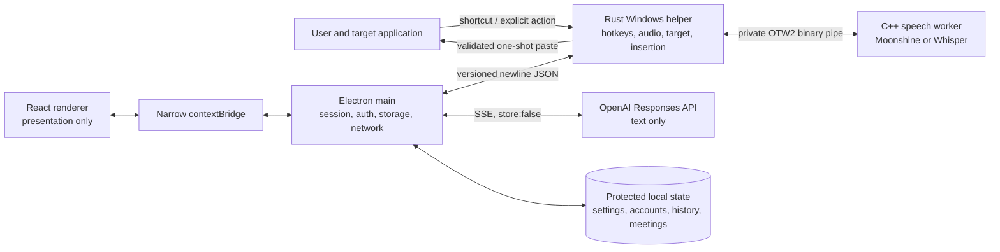

# OpenTalk Technical Overview and Engineering Architecture

**Version:** 0.2.0  
**Date:** 13 October 2026  
**Platform:** Windows x64, CPU-only local speech recognition  
**Status:** Working local preview. This is not a production-readiness, distribution-signing, or broad-compatibility claim.

## 1. Overview

OpenTalk is a local-first Windows desktop voice assistant for dictation, meetings, selected-text revision, and constrained text generation. It combines local audio capture and speech-to-text with account-backed OpenAI text processing, then inserts approved output into the application the user was already using. The system is designed around four invariants: audio stays local; cloud requests contain only the text needed for the feature; every session has an explicit lifecycle; and any automatic insertion has a budget of one guarded attempt.

The current implementation is an Electron desktop application with a React renderer, an authoritative TypeScript main process, a Rust Windows helper, and a persistent C++ speech worker. Moonshine is the default local speech engine; Whisper remains selectable. The packaged 0.2.0 preview is a per-user, unsigned NSIS installer and stores mutable state outside the installation directory under `%APPDATA%\OpenTalk`.

### Product capabilities

| Area | Features provided |
|---|---|
| Dictation | Hold `Ctrl+Shift` for 120 ms to begin; release to finish. The app captures the selected microphone, produces local incremental previews, performs optional cloud cleanup after release, and attempts one focus-guarded insertion. Users can disable capture, test the microphone, change the shortcut, and choose Moonshine or Whisper base/small models. |
| Dictation styles | Default, Minimal, Casual, Professional, and Extensive cleanup styles. The recording layer can use Default or Expressive status language and Default, Vibrant, or Gradient visual themes, with reduced-motion support. |
| Command Mode | A non-persistent toggle on the compact recording layer turns dictated instructions into text. It may generate or transform text, but has no tools, browsing, file access, software control, command execution, or message-sending capability. It shares dictation's cancellation, insertion, and history rules. |
| Voice command | The exact, deterministic phrase `Start Meeting` is recognized locally from the final transcript. It bypasses cleanup, history, and insertion and opens meeting capture only after the shortcut has been released. |
| Meetings and lectures | Start from `Ctrl+Shift+Space` or the hub. Capture the chosen microphone and user-selected Windows playback endpoint through WASAPI loopback, mix them in bounded 20 ms blocks, pause/resume, display live transcript revisions, and add up to 1,000 audio bookmarks linked to transcript positions. The raw transcript is saved before AI summarization. Meeting detail provides title, short summary, long summary, minutes, search, deletion, bookmark navigation, inert Markdown rendering, and explicit Markdown export. Speaker diarization and labels are not provided. |
| Selected-text Assistant | When an exact selection is available through Windows UI Automation, a separate bubble can record a voice instruction. The model receives only that selected text and the voice command. The result is reviewed before Replace or Add after selection. The original target is restored and revalidated; verified native edit controls can use `WM_PASTE`, otherwise the guarded single-attempt paste path is used. A copy fallback is offered when insertion is blocked. Assistant results are not added to dictation history. |
| Recovery after blocked insertion | If automatic insertion cannot be safely attempted, the main process can expose a copy-recovery action for up to 60 seconds. Text is written to the clipboard by the main process and is not returned to renderer state. The original insertion is not retried. |
| Overview | A dashboard shows weekly word and meeting counts, longest dictation, two recent dictations, and an account-usage link. It can generate an AI weekly recap from bounded current-week samples and aggregate counts. |
| Weekly Tasks | Extracts up to 50 explicit, self-assigned current-week tasks from protected dictations and ready meeting records, shows the top three on Overview, and supports navigation back to a source. Results are digest-cached in memory; there is no persistent task database. |
| Protected local records | Dictation history is off by default and, when enabled, stores DPAPI-protected records with search, paging, copy, duration metadata, and confirmed per-item deletion. Limits are 5,000 records or 50 MiB. Meetings use a separate protected store limited to 1,000 records or 50 MiB. History deliberately offers no Paste action. |
| Personalization and settings | Preferred vocabulary, cleanup style, microphone and playback choices, speech-model download/selection, read-only cleanup model and reasoning level, configurable dictation and meeting shortcuts, launch at login, keep-layer-visible, recording-layer appearance, Test Mic, account management, and global enable/disable. Default endpoint metadata follows normal Windows device changes while preserving an explicit manual choice. |
| Accounts and models | Direct browser-based Sign in with ChatGPT using loopback OAuth; add/select/reconnect/disconnect accounts; report local sign-out and remote-revocation state accurately; discover permitted text models; test cleanup; and open the external usage page. Model downloads use reviewed HTTPS origins, a pinned manifest, size and checksum verification, and atomic installation. |
| Desktop lifecycle | Single-instance hub and tray application, compact non-activating recording layer, three-second launch hint, optional always-visible idle layer, assistant/recording-layer mutual exclusion, expanded meeting recorder, topmost behavior, bounded interactive regions, and blocked navigation/new windows. |
| Packaging and diagnostics | Per-user Start-menu installation without elevation or a desktop shortcut; bundled pinned native/model assets; exact packaged-file and hash checks; and a privacy audit that rejects user profiles, cache/session data, API keys, PII-like paths, and unexpected content. Opt-in `OPENTALK_PERF=1` instrumentation records durations and counts, never transcript content. |

## 2. System Architecture

OpenTalk separates trusted coordination from high-frequency native work. The renderer owns presentation only. A narrow preload bridge exposes approved operations to it. The Electron main process authorizes sessions, owns credentials and protected storage, performs network requests, controls windows, and decides whether an insertion can proceed. The Rust helper owns keyboard and focus observation, WASAPI/CPAL audio capture, Windows UI Automation inspection, and insertion primitives. A persistent C++ worker embeds the local Moonshine and whisper.cpp runtimes. Tokens never enter the native processes; high-frequency PCM never crosses the renderer or Electron IPC path.



The local stores are deliberately separate: schema-versioned atomic `settings.json`; DPAPI-protected `accounts.enc`, `history.enc`, and `meetings.enc`; downloaded speech models; and a private temporary audio spool. This keeps preferences readable and migratable without placing tokens or sensitive text in plaintext.

### Dictation lifecycle and insertion sequence

```mermaid
sequenceDiagram
    participant U as User
    participant H as Rust helper
    participant M as Electron main
    participant W as Speech worker
    participant O as OpenAI Responses
    participant A as Target application

    U->>H: Hold Ctrl+Shift past 120 ms
    H->>M: start request and target snapshot
    M->>M: create UUID session; snapshot settings/account/mode
    M->>H: inspect target, prepare capture
    H->>W: bounded 16 kHz PCM stream
    W-->>M: ordered preview revisions and watermarks
    U->>H: Release shortcut
    H->>H: stop capture, drain callbacks, close/spool
    W-->>M: final transcript and complete watermark
    alt exact local Start Meeting command
        M->>M: open meeting flow; no cleanup/history/insertion
    else dictation or Command Mode
        M->>O: text, vocabulary/instructions; streamed request
        O-->>M: response.completed and non-empty output
        M->>M: reserve the only insertion attempt
        M->>H: text plus captured target identity
        H->>A: revalidate focus/security; one paste attempt
        H-->>M: attempted, notAttempted, or uncertain
        M->>M: conditional clipboard restore; protected history write
    end
```

Cancellation invalidates insertion authorization before stopping expensive work. Events are accepted only for the current session and in monotonically ordered revisions; late worker, network, or helper events are ignored after cancellation or completion. Release-time speculative cleanup may use the newest preview, but it is reused only when it exactly matches the final transcript. The session has a two-request cleanup budget, preventing unbounded duplicate plan usage.

## 3. Core Components

### 3.1 Audio capture and device handling

The Rust helper opens only the selected microphone for dictation and Assistant sessions. A Meeting session may additionally open only the user-selected render endpoint in WASAPI loopback mode. Capture performs mono averaging and stateful linear interpolation to 16 kHz signed 16-bit PCM. Meeting sources have independent resamplers and feed a bounded mixer that emits 320-sample, 20 ms blocks; a temporarily absent source contributes silence, and mixed samples are saturated rather than wrapped.

Backpressure is explicit: the audio channel is bounded to 256 blocks, the maximum native frame is 16,384 samples, and each meeting source buffer is capped at 16,000 samples. Sessions of up to 30 seconds can remain in memory. Longer input moves the complete prefix to a private current-user spool file, with a 2 GiB hard limit and 256 MiB disk-headroom requirement. Stop closes both capture streams, cancels preview work, drains callbacks, joins the writer, and sends end-of-stream; cancel and device loss take the same bounded cleanup route.

Device settings retain both an endpoint ID and whether it represents the normal Windows default. This allows normal default-device changes to reconcile automatically while an explicit user selection remains stable. Test Mic is isolated from ordinary session insertion.

### 3.2 Speech-to-text pipeline

The C++ worker is persistent so model and runtime initialization are amortized across sessions. Its private `OTW2` binary protocol carries message kind, revision, sample count, and overlap metadata; the worker accepts only expected versions and bounded payloads. Inference is CPU-only, uses at most eight threads, and has a 30-second task timeout.

Moonshine is the installed default. It keeps stream state and caches alive, accepts 4,000-sample chunks, performs approximately one-second interval decoding, and drains remaining audio on finalization. Whisper base and small remain selectable; the integration uses greedy English decoding, disables cross-session context, enables token timestamps for overlap handling, and includes a local abort callback patch. Preview cadence is approximately 250 ms for Moonshine and an adaptive two-second cadence for Whisper, with one preview inference active at a time. Model assets are data, never executable input, and are installed only after expected revision, byte size, and SHA-256 validation.

### 3.3 Focus-safe insertion

Insertion is treated as an authorization decision, not a convenience paste. At session start, the helper captures the window handle, process, native control identity, UI Automation runtime ID, focus generation, selection generation, and terminal classification. Immediately before insertion it rejects a changed target, locked or secure desktop, higher-integrity destination, password field, disabled control, missing editable/document role, or terminal. Assistant replacement additionally requires the original selected-text identity and selection to be restorable and revalidated.

All insertions pass through one bounded single-consumer worker. A preflight checks physical key state and refuses synthetic input while relevant modifiers or the action key are still held. Verified Edit, RichEdit, and Windows Forms edit controls may receive `WM_PASTE`; other accepted controls receive a serialized four-event `Ctrl+V` `SendInput` sequence. Partial acknowledgements release only synthetic key-downs owned by OpenTalk. Windows UIPI is respected; the application does not elevate or attempt to bypass a higher-integrity target.

Before paste, the helper snapshots up to 64 clipboard `HGLOBAL` formats and 32 MiB, excluding bitmap-heavy formats. It writes Unicode text, attempts insertion once, and restores the snapshot after the configured 200–2,000 ms delay only if the clipboard sequence still belongs to OpenTalk. A newer user copy is never overwritten. `attempted`, `notAttempted`, and `uncertain` outcomes are terminal; uncertainty never triggers a duplicate paste.

### 3.4 AI text processing

Provider traffic is owned by the main process and uses the documented Responses route with an `input` array, instructions/developer content, `store: false`, and `stream: true`. OpenTalk accepts output only after `response.completed` and non-empty validation. It rejects failed, incomplete, interrupted, canceled, empty, or tool-bearing responses. The configured cleanup model is GPT-5.6 Luna with reasoning effort `none`; the provider field is read-only in this preview.

Network payloads are feature-specific and bounded:

| Feature | Text sent | Text not sent |
|---|---|---|
| Dictation and Command Mode | Final local transcript, preferred vocabulary, fixed cleanup/generation instructions | Audio, target application content, screenshots, clipboard contents |
| Meeting summary | Saved raw transcript and fixed summarization instructions | Raw audio, playback device data, bookmarks, other application content |
| Selected-text Assistant | Exact UIA-selected text, locally transcribed voice instruction, fixed edit instructions | Surrounding document text, clipboard history, screenshots |
| Weekly recap | Aggregate counts plus up to 10 whole current-week dictations or ready meeting title/short-summary samples; 2 KiB per item and 12 KiB total | Audio, record identifiers, full meeting transcripts, minutes, bookmarks |
| Weekly Tasks | Up to 50 whole source items; 16 KiB each and 96 KiB total. A ready meeting contributes title/long summary; a non-ready meeting contributes its raw transcript. | Audio, bookmarks, unrelated records, persistent task state |

`store: false` is a request setting, not a promise of zero provider retention. Authentication uses a browser and loopback callback on `127.0.0.1`, with fresh PKCE, state, and nonce per attempt. The main process validates the callback and ID token, keeps account/workspace registrations distinct, serializes refreshes, and atomically stores rotating refresh tokens with Windows-protected storage.

### 3.5 Session lifecycle and UI coordination

Every dictation, meeting, and Assistant capture receives a unique session ID and explicit state. Renderer views subscribe to authoritative snapshots; they do not infer permission from animation state. The compact recording layer is non-activating and click-through outside bounded controls so it does not steal focus from the target. Recording and Assistant layers are mutually exclusive, and transitions use a 280 ms content-sized motion system with a reduced-motion branch. Meeting mode expands into a dedicated recorder with controls for pause, resume, bookmarks, and finish.

The hub exposes Overview, Weekly Tasks, Dictation History, Meetings, Commands, Dictionary, Styles, Settings, and account/model management. External links are restricted to approved HTTPS destinations. Meeting Markdown is rendered inertly, and export is an explicit user action. No renderer receives raw credentials, unrestricted IPC, arbitrary filesystem or HTTP access, process spawning, or clipboard getters.

## 4. Engineering Challenges and Solutions

**Race-free finalization.** Audio callbacks, preview inference, model streaming, focus changes, and user cancellation occur concurrently. OpenTalk assigns ordered revisions and watermarks, treats the main coordinator as the session authority, invalidates insertion before asynchronous teardown, and drains capture before accepting the final transcript. Exact-match reuse and request budgets constrain speculative cleanup.

**Global shortcut correctness.** The dictation gesture shares physical modifiers with ordinary Windows shortcuts. The helper observes only configured shortcuts, keeps the low-level hook callback small, passes Ctrl and Shift through, and cancels a pending hold when a third application shortcut key appears. Explicit synthetic `Ctrl+C`/`Ctrl+V` is serialized and ignored by OpenTalk's own hook to prevent recursion.

**Safe automation across applications.** Windows controls expose inconsistent UIA and native behavior. OpenTalk records multiple target identities, requires exact passive selection for Assistant, chooses `WM_PASTE` only for verified edit classes, otherwise uses guarded `SendInput`, and falls back to Copy rather than weakening validation. This prevents “successful” output from landing in a newly focused or secure field.

**Low-latency local inference.** Persistent model processes, short bounded PCM frames, Moonshine streaming caches, preview cancellation, and private spooling keep the renderer and hook thread unblocked. The architecture avoids shipping high-rate PCM through Electron IPC and avoids reloading models for each dictation.

**Crash-safe sensitive state.** Settings use schema-versioned atomic writes; tokens and text records use DPAPI protection and atomic replacement. Bounded queues, byte limits, startup spool cleanup, typed errors, and deterministic terminal outcomes prevent silent truncation, unbounded memory, and retry-induced duplicates.

## 5. Security and Privacy Model

OpenTalk's trust boundary is the Electron main process. Renderers load trusted packaged local content with Node integration disabled, context isolation enabled, sandboxing where compatible, a restrictive Content Security Policy, a custom local protocol, runtime IPC schemas, sender/origin checks, and blocked unexpected navigation, pop-ups, and permissions. The preload exposes a narrow `contextBridge` contract rather than `ipcRenderer`.

Audio is processed locally and deleted from temporary storage on success, failure, cancellation, and next-launch cleanup; this is not a claim of forensic secure erasure. Transcripts, vocabulary, selections, summaries, and model output are excluded from diagnostic logs and analytics. History defaults off. DPAPI protection is tied to the Windows user context, so it reduces plaintext exposure but does not defend against code already running as that user.

OAuth tokens remain in the main process and protected account store. The implementation uses exact loopback redirect matching, state/nonce/PKCE validation, issuer/audience/expiry/nonce verification, separate plan-permission checks, serialized refresh per registration, and bounded revocation handling. Sign-out stops new requests, attempts documented revocation, clears local credentials, and distinguishes confirmed remote revocation from local-only removal.

Native binaries are spawned from trusted packaged locations with argument arrays and shell execution disabled. Native IPC validates versions, message kinds, sizes, session IDs, and allowed paths; no token is passed to the helper or speech worker. Downloaded model data is restricted to reviewed HTTPS origins and accepted only after pinned checksum validation. The packaging privacy audit checks exact expected runtime/native/model files and rejects profiles, browser/session caches, API-key patterns, user-path leakage, and unexpected package contents.

Known residual risks are explicit: the installer is unsigned; third-party notice and licensing completeness require release review; DPAPI has same-user limitations; `store: false` does not define provider retention; and real cross-application focus, accessibility, integrity, and clipboard interactions require attended Windows testing.

## 6. Performance, Testing, and Reliability

The current codebase has a reproducible strict TypeScript check, lint, offline test suite, renderer/main production builds, native builds, installer packaging, and package-content/privacy verification. At the 0.2.0 checkpoint, `npm.cmd run check` passed **243 offline tests** plus type-check, lint, and production builds. The latest keyboard/selection native run passed **30 native tests**, with **2 opt-in attended tests ignored by default**.

Measured evidence is deliberately scoped:

- A public approximately 11-second Whisper fixture ran 20 times at 844 ms median and 878 ms p95 after worker tuning; the earlier median/p95 was 895/1,127 ms. This shows reduced variation, not a proven throughput gain.
- Historical synthetic 194–198 words-per-minute dictations completed recognition in 1.314, 1.529, 1.949, and 2.281 seconds. The aspirational one-second full-path target was not met.
- One real-time-paced public-audio Moonshine sample recorded 664 ms from stop to final recognition. Moonshine preparation was measured at 761 ms cold and 5 ms reused; a contemporary Whisper measurement was 362 ms cold and 1 ms reused.
- The measured Whisper worker used about 255.7 MiB physical RAM and 751.5 MiB private commit in that run, excluding the Electron application. There is no current full-process CPU/memory certification.

These figures are development observations on specific fixtures and machines, not general service-level guarantees. There is no current word-error-rate benchmark, formatted-field end-to-end percentile series, broad target-application compatibility matrix, long refresh-endurance result, or production stress certification. Unit and integration coverage emphasize state transitions, cancellation, stale-event rejection, completed-stream validation, bounded storage and queues, selection/focus guards, and duplicate-paste prevention. Native automation is opt-in and limited to disposable test targets; live account/model tests require an explicitly chosen account because they consume plan usage.

## 7. Roadmap and Readiness

### Implemented in the working preview

The full feature inventory in Section 1 is present in source, including local Moonshine/Whisper dictation, guarded insertion and copy recovery, protected history, meetings with selected playback capture/bookmarks/summaries/export, selected-text Assistant, Command Mode, deterministic meeting voice command, overview recap, weekly task extraction, themes/styles, direct account flow, model management, privacy-audited packaging, and the 0.2.0 installer.

### In development or awaiting attended evidence

- Launch and exercise the 0.2.0 installer on a clean Windows account and over a prior version; verify uninstall, Start-menu behavior, mutable data preservation, bundled native/model startup, and no dependency on the source tree.
- Run live subscription acceptance with an explicitly selected test account for OAuth, model discovery, rotating refresh, cleanup, meeting summarization, recap, tasks, Assistant, and revocation. This must report plan usage and terminal stream failures accurately.
- Run controlled real-microphone and selected-playback meeting sessions, then validate raw transcript durability, summary recovery, pause/resume, bookmark alignment, device removal, and teardown.
- Complete attended insertion and Assistant compatibility checks across approved disposable targets, including Notepad and representative native/editable applications. Secure fields, elevated targets, terminals, selection changes, focus changes, and newer clipboard ownership must remain blocked.

### Future hardening

Before a release claim, the project needs code signing, complete third-party license review, broader accessibility and Windows compatibility evidence, repeatable WER/latency/resource benchmarks, crash/refresh endurance, and a documented support envelope. Any future update mechanism must verify signed packages before execution. Speaker diarization, hosted transcription fallback, a backend/database, agentic tool execution, broad application-content harvesting, and automatic form submission are intentionally outside the present scope.

## References

Implementation claims are traceable in [TECHNICAL_BRIEF_SOURCES.md](TECHNICAL_BRIEF_SOURCES.md). External design guidance was checked against the official [OpenAI sign-in documentation](https://developers.openai.com/siwc/token-sharing-open-source/sign-in), [OpenAI models and inference documentation](https://developers.openai.com/siwc/token-sharing-open-source/models-and-inference), [OpenAI profiles and sessions documentation](https://developers.openai.com/siwc/token-sharing-open-source/profiles-and-sessions), [Electron security guidance](https://www.electronjs.org/docs/latest/tutorial/security), [Electron safeStorage documentation](https://www.electronjs.org/docs/latest/api/safe-storage), [Microsoft SendInput documentation](https://learn.microsoft.com/windows/win32/api/winuser/nf-winuser-sendinput), and [Microsoft LowLevelKeyboardProc documentation](https://learn.microsoft.com/windows/win32/winmsg/lowlevelkeyboardproc).
